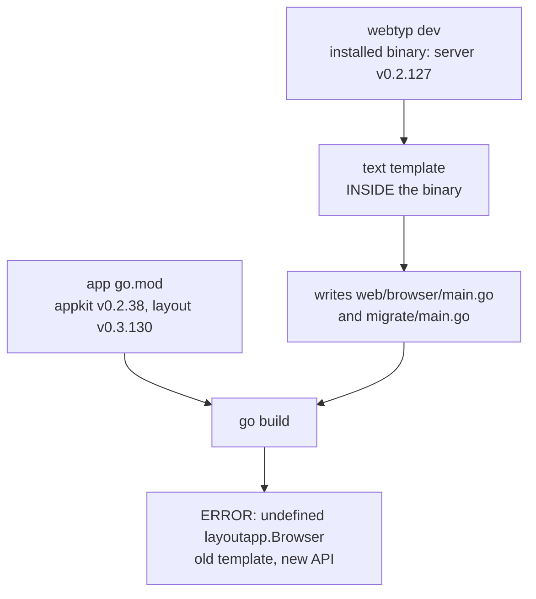
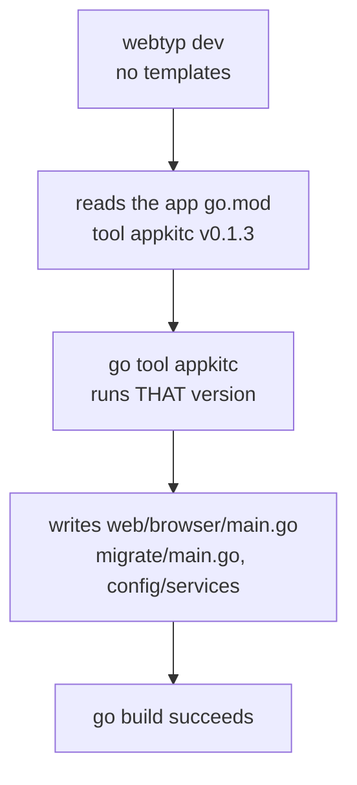
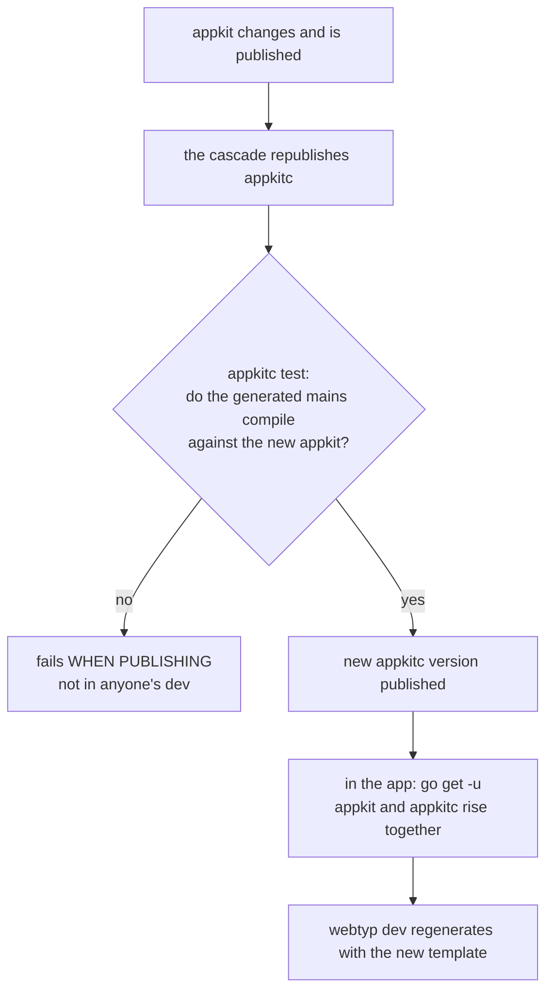

# How the main files of an app are generated

Shows how `appkitc` writes the `main` files of an app and why its templates cannot be older than the libraries: the app's `go.mod` pins the version. `webtyp dev` triggers it on start and when the models or `go.mod` change. Verified by [tests/fixtureapp_test.go](../../tests/fixtureapp_test.go) and [tests/maingen_test.go](../../tests/maingen_test.go).

## Before: the template travelled inside the `webtyp` binary

1. `webtyp dev` is an installed binary; its template is the one of the version it was built with.
2. It rewrote the `main` files even when the app's `go.mod` used newer libraries.
3. `go build` failed: the old template called an API that no longer exists.

## Now: each `webtyp dev` runs the version the app pinned

1. `webtyp dev` only reads the app's `go.mod` (`tool webtyp.com/appkitc/cmd/appkitc`) and runs `go tool appkitc`; if the line is missing it adds it first.
2. `go tool` builds `appkitc` the first time (a few seconds, then cached) and runs that exact version.
3. It writes `web/server/main.go`, `web/browser/main.go`, `migrate/main.go` and `config/services`; if any file changed it runs `go mod tidy`, then `go build` succeeds.
4. Error branches: no `go.mod` or the tool cannot be added → `server.ErrGeneratorNotInstalled`; the generator stops → `server.ErrGeneratorFailed`; each says what to run.

## How it stays in step with the libraries

1. `appkit` changes and is published.
2. The cascade republishes `appkitc`; its fixture test generates the `main` files and compiles them against the new `appkit`.
3. If they do not compile, publishing fails there, never in somebody's `webtyp dev`.
4. If they compile, the app runs `go get -u` and `appkit` and `appkitc` rise together; if only `appkit` rose, «Update libraries» runs `go get webtyp.com/appkitc@latest`.
