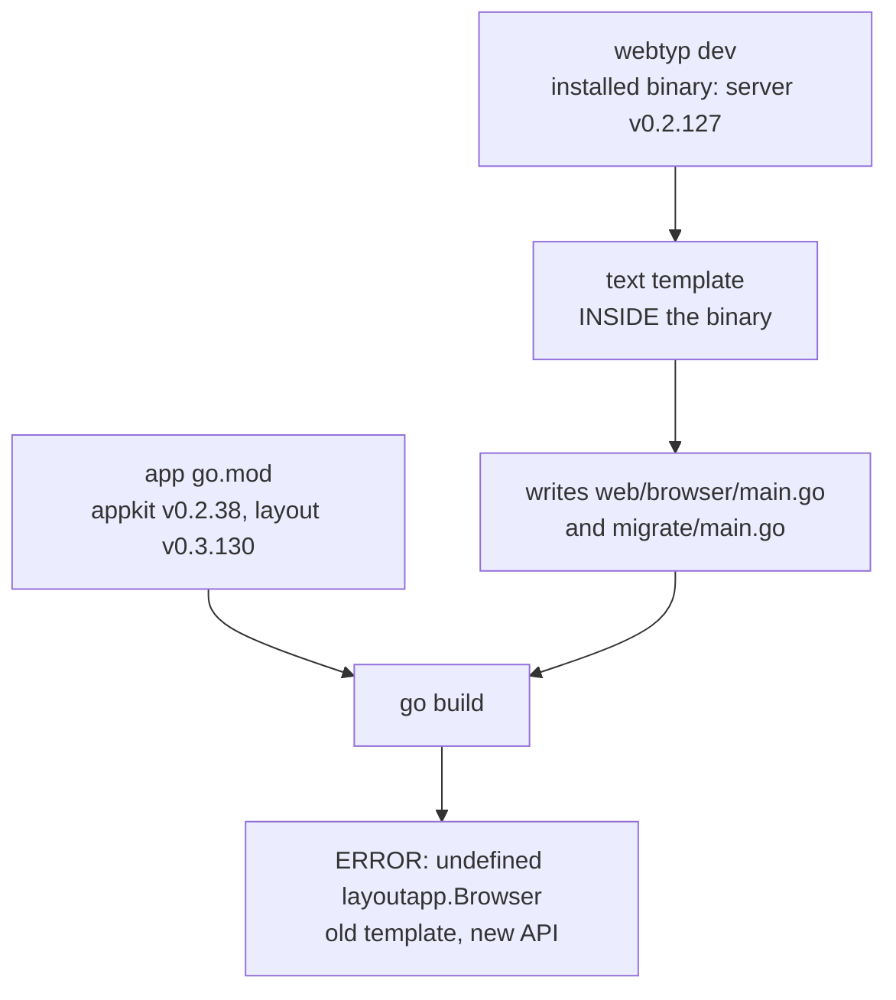
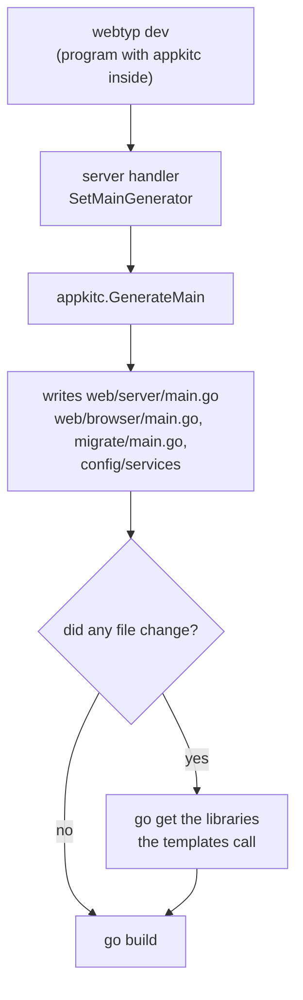
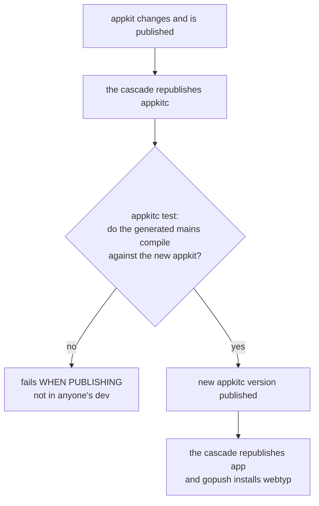

# How the main files of an app are generated

Shows how `appkitc` writes the `main` files of an app and how a template that no longer matches the libraries is stopped before it is published. `webtyp dev` triggers it on start and when the models or `go.mod` change. Verified by [tests/fixtureapp_test.go](../../tests/fixtureapp_test.go) and [tests/maingen_test.go](../../tests/maingen_test.go).

## Before: the template was text inside `webtyp.com/server`

1. `webtyp dev` is an installed binary; its template is the one of the version it was built with.
2. It rewrote the `main` files even when the app's `go.mod` used newer libraries.
3. `go build` failed: the old template called an API that no longer exists.

## Now: the generator is compiled against the libraries before it is published

1. `webtyp dev` starts the server handler; the program connects `appkitc` to it before the first generation. Without one connected, the handler fails with `server.ErrNoMainGenerator`.
2. `GenerateMain` writes the files of the app (never a file without the generated header).
3. If any file changed it runs `go get <library>@latest` for each library the templates call, then `go build` succeeds.
4. The app's `go.mod` never lists `appkitc`.

## How a template that no longer matches the libraries is stopped

1. `appkit` changes and is published.
2. The cascade republishes `appkitc`; its fixture test generates the `main` files and compiles them against the new `appkit`.
3. If they do not compile, publishing fails there, never in somebody's `webtyp dev`.
4. If they compile, `app` is republished and the installed `webtyp` carries the new templates; an older installed `webtyp` still writes older templates until it is reinstalled.
