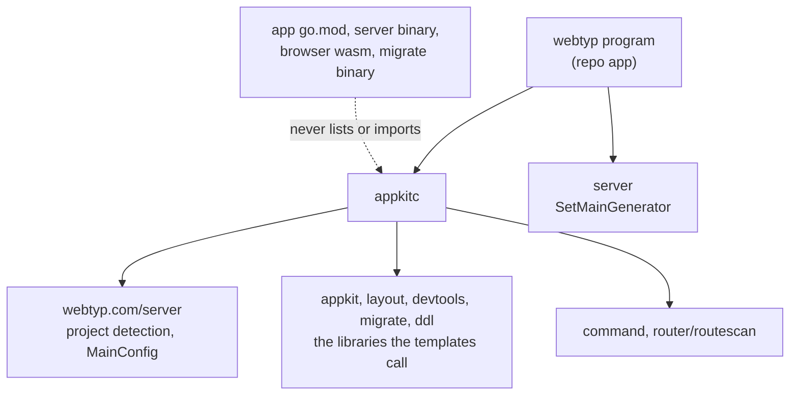

# Where appkitc sits

Shows what `appkitc` imports and who uses it. It runs only on the developer's machine, inside the `webtyp` program; no app lists it and no production binary contains it. Verified by `TestFixtureApp_MainsDoNotImportTheGenerator` in [tests/fixtureapp_test.go](../../tests/fixtureapp_test.go).

1. `app` imports `appkitc` and connects its `GenerateMain` to the server handler.
2. `appkitc` imports `server` for what the handler and the generator share, and the libraries its templates call, so a template that does not compile fails its own tests.
3. The apps the generator writes for never list `appkitc`.
