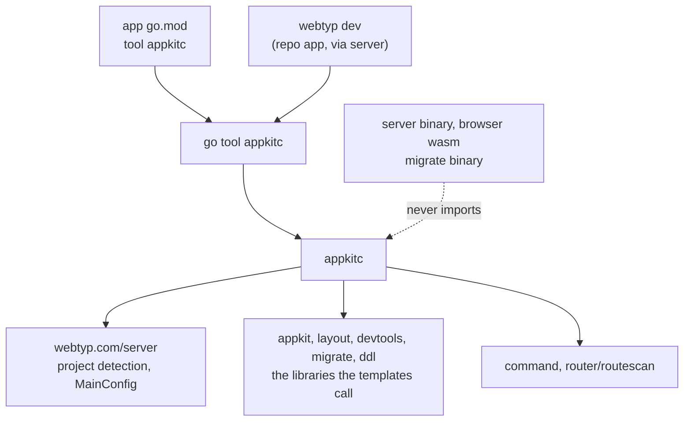

# Where appkitc sits

Shows what `appkitc` imports and who runs it. It runs only on the developer's machine, started by `webtyp dev`; no production binary contains it. Verified by `TestFixtureApp_MainsDoNotImportTheGenerator` in [tests/fixtureapp_test.go](../../tests/fixtureapp_test.go).

1. The app's `go.mod` pins `appkitc`; `webtyp dev` (through `server.RunGenerator`) runs it with `go tool`.
2. `appkitc` imports `server` for what the handler and the generator share, and the libraries its templates call, so a template that does not compile fails its own tests.
3. The generated binaries of the app never import `appkitc`.
